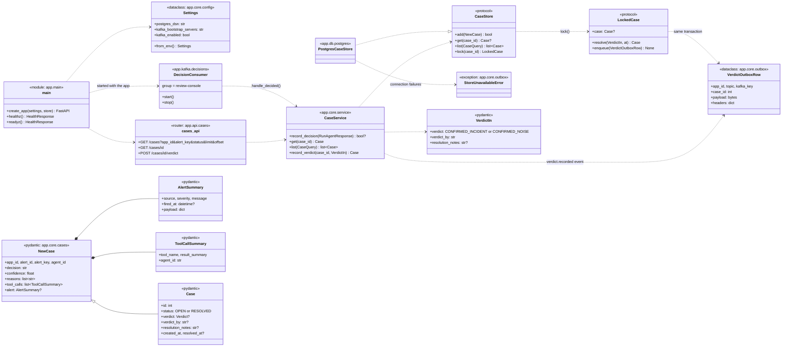

# review-console — class diagram

As built through Day 20 of `docs/plan.md` (Day 15 moved verdicts onto
`verdict_outbox`, ADR-0024; Day 18 added `/readyz`, the same as
`/healthz`; cases for all three apps since Day 20, no code change): an `alert.decided` consumer that turns
escalations into cases, the analyst REST API, and the `verdict_outbox`
writer that the `outbox-relay` worker publishes as `verdict.recorded`. Since Day 13 `GET /cases` has a second
reader: `tool-gateway`'s global `similar-past-case-lookup` asks it for
`status=RESOLVED` cases on the run's `app_id` + `alert_key` (ADR-0027).

- **`case_from_decision()`** (`app.core.cases`) is the persistence filter:
  only `ESCALATE` becomes a `NewCase`; `AUTO_RESOLVE`/`SUPPRESS` return
  `None`. It copies `RunAgentResponse.alert` into `AlertSummary` (`None`
  for a decision published before ADR-0023) and each `ToolCall`'s
  `agent_id`. `PostgresCaseStore.add` is `ON CONFLICT (app_id, alert_id) DO
  NOTHING`, so a redelivered decision never creates a second case.
- **`CaseService.record_verdict`** holds the state machine, under
  `lock()` (`SELECT ... FOR UPDATE`): no case → `CaseNotFoundError` (404),
  `RESOLVED` → `CaseAlreadyResolvedError` (409), else `resolve()` and
  `enqueue()` the `verdict.recorded` event into `verdict_outbox`, in the
  same transaction (ADR-0024). Both commit or neither does. Kafka isn't on
  this path: a verdict succeeds during an outage and the `outbox-relay`
  worker publishes it later, timestamped by the row's `created_at`. Only
  a Postgres connection failure is `StoreUnavailableError` (503, nothing
  committed). This closes the Day 11 gap where a timed-out publish could
  reach `memory-store` for a case that stayed `OPEN`.
- **`verdict_event()`** builds the `verdict.recorded` body: `{app_id,
  case_id, alert_key, verdict, verdict_by, recorded_at}`, keyed
  `{app_id}:{alert_key}`. `resolution_notes` stays on the case (ADR-0011).
- **`DecisionConsumer`**: own group, one message at a time, commit after
  handling; unusable messages are skipped, Postgres errors retried.
- With `KAFKA_ENABLED=false`, `main` doesn't start the consumer; cases and
  verdicts work as usual (verdict rows wait in `verdict_outbox`).
