# tool-gateway — class diagram

As built through Day 14 of `docs/plan.md` (Day 12: timeout, retry and
circuit breaker, the registered-schema check, `TOOL_FAULTS`; Day 13: the
version check, the global `similar-past-case-lookup`, app #2's
`billing-lookup`; unchanged on Day 14). `tool-gateway` is the platform's
MCP server. At startup it imports every app's tool modules from
`backend/apps/*/tools/` into a `ToolRegistry`, and adds the platform's own
global tools from `app/tools/`. It then serves MCP `tools/list` and
`tools/call` over stateless Streamable HTTP at `POST /mcp`. Every call is
checked against the calling agent's tools as `registry` resolves them
before it runs, and runs under a deadline, retries and a per-tool circuit
breaker. Every tool is a read-only lookup (ADR-0004).

Naming: `ToolRegistry` is this service's in-memory table of *loaded* tool
code. The `registry` *service* (and `ap-shared`'s `RegistryClient`) is
where apps, agents and tool permissions live.

Python modules that are plain functions (no class) are drawn as
`<<module>>` boxes. Third-party, cross-service and app-owned types are in
the `external` and `app_tools` groups.

```mermaid
classDiagram
    direction LR

    namespace entrypoint {
        class main {
            <<module>>
            +SERVICE_NAME = "tool-gateway"
            +MCP_PATH = "/mcp"
            +DEFAULT_APPS_DIR: Path
            +DEFAULT_ALLOWED_HOSTS: str
            +DEFAULT_REGISTRY_URL: str
            +DEFAULT_REVIEW_CONSOLE_URL: str
            +create_app(apps_dir, allowed_hosts, apps, cases) FastAPI
            -lifespan(app) AsyncIterator
            +healthz() HealthResponse
            +readyz() HealthResponse
        }
        class HealthResponse {
            <<pydantic>>
            +status: str
            +service: str
        }
    }

    namespace core {
        class ToolRegistry {
            -_tools: dict~str, ToolSpec~
            +add(tool: ToolSpec) None
            +get(tool_id) ToolSpec
            +list() list~ToolSpec~
            +__len__() int
        }
        class ToolSpec {
            <<frozen dataclass>>
            +tool_id: str
            +version: str
            +description: str
            +scope: app or global
            +app_id: str?
            +input_model: type~BaseModel~
            +output_model: type~BaseModel~
            +handler: Callable
            +read_only: bool
            +takes_context: bool
            +input_schema() dict
            +output_schema() dict
            +validate(arguments) BaseModel
            +run(args, context) BaseModel
            +invoke(arguments) BaseModel
        }
        class ToolNotFoundError {
            <<exception: LookupError>>
            +tool_id: str
        }
        class DuplicateToolError {
            <<exception: ValueError>>
        }
        class loader {
            <<module: app.core.loader>>
            +load_app_tools(apps_dir, registry) None
            -_import_by_path(app_id, module_path) ModuleType
            -_tool_specs(app_id, module_path, module) list~ToolSpec~
            -_tool_spec(app_id, module_path, tool_id, definition) ToolSpec
        }
        class ToolLoadError {
            <<exception: RuntimeError>>
        }
        class ResiliencePolicy {
            <<frozen dataclass>>
            +timeout_s = 5.0
            +max_attempts = 3
            +base_delay_s = 0.1
            +max_delay_s = 1.0
            +failure_threshold = 5
            +cooldown_s = 30.0
            +from_env(env)$ ResiliencePolicy
        }
        class ToolRunner {
            -_policy: ResiliencePolicy
            -_breakers: dict~str, CircuitBreaker~
            +breaker(tool_id) CircuitBreaker
            +run(tool_id, attempt) Any
            +delay_s(attempt) float
            -_with_retries(tool_id, attempt) Any
        }
        class CircuitBreaker {
            +name: str
            +state: CircuitState
            +before_call() None
            +on_success() None
            +on_failure() None
            +on_cancel() None
        }
        class CircuitState {
            <<enum>>
            CLOSED
            OPEN
            HALF_OPEN
        }
        class ToolTimeoutError {
            <<exception: TimeoutError>>
        }
        class CircuitOpenError {
            <<exception: RuntimeError>>
        }
        class faults {
            <<module: app.core.faults>>
            +apply_faults(spec, registry) ToolRegistry
            -_parse(spec) dict
            -_broken(tool, fault) Callable
        }
        class InjectedFaultError {
            <<exception: RuntimeError>>
        }
    }

    namespace mcp_layer {
        class mcp_server {
            <<module: app.mcp.server>>
            +SERVER_NAME = "tool-gateway"
            +build_mcp_server(registry, apps, runner) Server
            +call_tool(registry, apps, runner, schemas, name, arguments, context) CallToolResult
            -_allowed_tools(apps, context) dict~str, dict~
            -_to_mcp_tool(tool) Tool
            -_error(code, message, extra) CallToolResult
        }
        class RegisteredSchemas {
            -_validators: dict~str, Draft202012Validator~
            +validator(schema) Draft202012Validator
        }
        class on_list_tools {
            <<closure handler>>
            tools/list
        }
        class on_call_tool {
            <<closure handler>>
            tools/call
        }
        class AppSource {
            <<Protocol>>
            +get_app(app_id) dict
        }
    }

    namespace global_tools {
        class similar_past_cases {
            <<module: app.tools.similar_past_cases>>
            +TOOL_ID = "similar-past-case-lookup"
            +VERSION = "1.0.0"
            +build_tool(cases) ToolSpec
        }
        class CaseSource {
            <<Protocol>>
            +resolved_cases(app_id, alert_key, limit) list~dict~
        }
        class ReviewConsoleCases {
            -_http: httpx.AsyncClient
            +resolved_cases(app_id, alert_key, limit) list~dict~
            +aclose() None
        }
        class SimilarPastCasesInput {
            <<pydantic, extra=forbid>>
            +limit: int = 3, 1..10
        }
        class SimilarPastCasesOutput {
            <<pydantic, extra=forbid>>
            +found: bool
            +alert_key: str
            +cases: list~PastCase~
            +message: str?
        }
        class PastCase {
            <<pydantic, extra=forbid>>
            +case_id: int
            +decided_at, resolved_at
            +decision: str
            +reasons: list~str~
            +verdict: str?
            +resolution_notes: str?
        }
    }

    namespace external {
        class Server {
            <<mcp SDK>>
        }
        class StreamableHTTPSessionManager {
            <<mcp SDK, stateless + json_response>>
            +run() AsyncContextManager
        }
        class StreamableHTTPASGIApp {
            <<mcp SDK ASGI app>>
        }
        class TransportSecuritySettings {
            <<mcp SDK>>
            +enable_dns_rebinding_protection
            +allowed_hosts
        }
        class RunContext {
            <<ap-shared run_context>>
            +app_id: str
            +agent_id: str
            +alert_id: str
            +alert_key: str
        }
        class run_context {
            <<ap-shared module>>
            +from_meta(meta) RunContext?
        }
        class CallToolResult {
            <<mcp_types>>
            +content: list~TextContent~
            +structured_content: dict
            +is_error: bool
        }
        class Tool {
            <<mcp_types>>
            +name, description
            +input_schema, output_schema
            +annotations: read_only_hint
            +meta: version, scope, app_id, read_only
        }
        class Draft202012Validator {
            <<jsonschema>>
        }
        class RegistryClient {
            <<ap-shared registry_client>>
            +get_app(app_id) dict
            +aclose() None
        }
        class AppNotFoundError {
            <<ap-shared registry_client>>
        }
        class RegistryUnavailableError {
            <<ap-shared registry_client>>
        }
    }

    namespace app_tools {
        class AppToolModule {
            <<contract: backend/apps/app_id/tools/*.py>>
            +TOOLS: dict~tool_id, definition~
        }
        class lookup_runbook {
            <<module: it-ops-triage/tools/lookup_runbook.py>>
            +RUNBOOKS: dict~str, RunbookEntry~
            +lookup_runbook(args) LookupRunbookOutput
            -_load_runbooks(path) dict
        }
        class LookupRunbookInput {
            <<pydantic, extra=forbid>>
            +alert_type: str
        }
        class recent_changes_lookup {
            <<module: it-ops-triage/tools/recent_changes_lookup.py>>
            +CHANGES: list~Change~
            +recent_changes_lookup(args) RecentChangesOutput
            -_load_changes(path) list
        }
        class RecentChangesInput {
            <<pydantic, extra=forbid>>
            +service_or_host: str
            +window_start, window_end: AwareDatetime
        }
        class RecentChangesOutput {
            <<pydantic, extra=forbid>>
            +service_or_host: str
            +window_start, window_end
            +found: bool
            +changes: list~Change~
            +message: str?
        }
        class Change {
            <<pydantic, extra=forbid>>
            +ref, service, author, summary: str
            +timestamp: AwareDatetime
            +type: deploy or config or infra
            +hosts: list~str~
        }
        class LookupRunbookOutput {
            <<pydantic>>
            +found: bool
            +alert_type: str
            +runbook: RunbookEntry?
            +message: str?
        }
        class RunbookEntry {
            <<pydantic>>
            +runbook_id: str
            +alert_type: str
            +title: str
            +description: str
            +likely_causes: list~str~
            +diagnostic_checks: list~str~
            +suggested_action: str
            +action_conditions: str
            +owner_team: str
            +severity_hint: str
        }
        class billing_lookup {
            <<module: cost-anomaly-triage/tools/billing_lookup.py>>
            +ITEMS: list~LineItem~
            +billing_lookup(args) BillingLookupOutput
            -_load_items(path) list
        }
        class BillingLookupInput {
            <<pydantic, extra=forbid>>
            +service, region: str
            +window_start, window_end: AwareDatetime
        }
        class BillingLookupOutput {
            <<pydantic, extra=forbid>>
            +service, region
            +window_start, window_end
            +found: bool
            +total_cost_usd: float
            +by_resource: list~ResourceCost~
            +other_resources_cost_usd: float
            +by_tag: list~TagCost~
            +untagged_cost_usd: float
            +message: str?
        }
        class LineItem {
            <<pydantic, extra=forbid>>
            +date, service, region
            +resource_id, resource_type
            +cost_usd: float
            +tags: dict
        }
        class ResourceCost {
            <<pydantic, extra=forbid>>
            +resource_id, resource_type
            +cost_usd: float
            +tags: dict
        }
        class TagCost {
            <<pydantic, extra=forbid>>
            +key, value: str
            +cost_usd: float
        }
    }

    %% composition root
    main *-- ToolRegistry : app.state.registry
    main ..> loader : load_app_tools at startup
    main ..> similar_past_cases : build_tool, registry.add
    main ..> faults : apply_faults if TOOL_FAULTS
    main *-- ToolRunner : ResiliencePolicy.from_env
    main ..> mcp_server : build_mcp_server
    main *-- StreamableHTTPSessionManager : lifespan runs it
    main *-- StreamableHTTPASGIApp : Route POST /mcp
    main ..> TransportSecuritySettings : DNS-rebinding guard
    main ..> HealthResponse
    main *-- RegistryClient : unless apps injected, closed in lifespan
    main *-- ReviewConsoleCases : unless cases injected, closed in lifespan
    StreamableHTTPSessionManager o-- Server
    StreamableHTTPASGIApp --> StreamableHTTPSessionManager

    %% registry
    ToolRegistry o-- ToolSpec : keyed by tool_id
    ToolRegistry ..> ToolNotFoundError : get raises
    ToolRegistry ..> DuplicateToolError : add raises

    %% loader
    loader ..> AppToolModule : imports by file path
    loader ..> ToolSpec : builds, scope=app
    loader ..> ToolRegistry : add
    loader ..> ToolLoadError : any problem fails startup

    %% resilience
    ToolRunner *-- ResiliencePolicy
    ToolRunner *-- CircuitBreaker : one per tool_id
    CircuitBreaker --> CircuitState
    ToolRunner ..> ToolTimeoutError : deadline passed
    CircuitBreaker ..> CircuitOpenError : before_call raises

    %% faults
    faults ..> ToolRegistry : returns a copy
    faults ..> InjectedFaultError : error fault raises

    %% MCP
    mcp_server ..> Server : creates
    Server --> on_list_tools
    Server --> on_call_tool
    on_list_tools ..> ToolRegistry : list
    on_list_tools ..> Tool : via _to_mcp_tool
    on_call_tool ..> run_context : from_meta
    on_call_tool ..> mcp_server : call_tool
    mcp_server --> AppSource : allowlist, version, schema
    RegistryClient ..|> AppSource
    mcp_server ..> AppNotFoundError : catches -> no tools
    mcp_server ..> RegistryUnavailableError : catches -> registry_unavailable
    mcp_server ..> ToolRegistry : get
    mcp_server *-- RegisteredSchemas : one per server
    RegisteredSchemas ..> Draft202012Validator : compiled once per schema
    mcp_server ..> ToolRunner : run(tool.run)
    mcp_server ..> CallToolResult : success or is_error
    run_context ..> RunContext

    %% global tool
    similar_past_cases ..> ToolSpec : scope=global, takes_context
    similar_past_cases --> CaseSource
    ReviewConsoleCases ..|> CaseSource : GET /cases status=RESOLVED
    similar_past_cases ..> RunContext : app_id + alert_key
    similar_past_cases ..> SimilarPastCasesInput
    similar_past_cases ..> SimilarPastCasesOutput
    SimilarPastCasesOutput *-- PastCase

    %% app tools
    lookup_runbook ..|> AppToolModule : exports TOOLS
    lookup_runbook ..> LookupRunbookInput
    lookup_runbook ..> LookupRunbookOutput
    recent_changes_lookup ..|> AppToolModule : exports TOOLS
    recent_changes_lookup ..> RecentChangesInput
    recent_changes_lookup ..> RecentChangesOutput
    RecentChangesOutput *-- Change
    LookupRunbookOutput *-- RunbookEntry
    billing_lookup ..|> AppToolModule : exports TOOLS
    billing_lookup ..> BillingLookupInput
    billing_lookup ..> BillingLookupOutput
    billing_lookup o-- LineItem : ITEMS
    BillingLookupOutput *-- ResourceCost
    BillingLookupOutput *-- TagCost
    ToolSpec ..> LookupRunbookInput : input_model
    ToolSpec ..> LookupRunbookOutput : output_model
```

## Classes and modules

### Entry point — `app/main.py`

**`main` (module)** is the composition root. `create_app(apps_dir,
allowed_hosts, apps, cases)` does the setup:
1. Builds an empty **`ToolRegistry`** and fills it with
   **`load_app_tools()`**. Any bad tool module fails startup here.
2. Adds the global tools: `similar_past_cases.build_tool(cases)`, where
   `cases` is a fake in tests, otherwise a **`ReviewConsoleCases`** on
   `REVIEW_CONSOLE_URL` (default `http://localhost:8006`).
3. If `TOOL_FAULTS` is set, swaps the registry for a copy with those tools
   deliberately broken (**`faults`**, below).
4. Builds one **`ToolRunner`** from `ResiliencePolicy.from_env()`.
5. Uses `apps` as the source of agents' resolved tools: a fake in tests,
   otherwise a **`RegistryClient`** on `REGISTRY_URL` (default
   `http://localhost:8005`) with `MANIFEST_TTL_S` (default 30, the same
   as `orchestrator` and `ingestion`).
6. Wraps them in an MCP **`Server`** (`build_mcp_server`).
7. Hosts that server in a **`StreamableHTTPSessionManager`** with
   `stateless=True` and `json_response=True`. Every call is one
   request/response, so any replica can serve any call and rolling
   updates need no sticky sessions.
8. Enables DNS-rebinding protection through **`TransportSecuritySettings`**,
   which checks the `Host` header against `MCP_ALLOWED_HOSTS` (default
   `localhost:*`, `127.0.0.1:*`, `tool-gateway:*`).
9. Mounts the session manager at `/mcp` as a plain `Route`, not a
   `Mount`. A `Mount` would 307-redirect `/mcp` to `/mcp/`.

`lifespan()` runs the session manager's task group and, on shutdown, closes
the `RegistryClient` and `ReviewConsoleCases` if `create_app()` made them.
**`HealthResponse`** is the `/healthz` body. The registry is also kept on
`app.state.registry` for tests.

### Core — `app/core/registry.py`

**`ToolSpec`**: one loaded tool, the gateway's internal tool model.
- **Identity**: `tool_id`, `version`, `description`, `scope` (`app` or
  `global`), and `app_id` (the owner for `app` scope, `None` for global).
- **Behaviour**: `input_model` and `output_model` (pydantic classes) plus
  `handler`.
- **`read_only`**: as declared by the tool's author; the loader only
  accepts `True`. It's advertised over MCP so `register_app.py` can
  register it in `registry`, which also rejects anything else.
- **`takes_context`**: global tools only. The handler is called as
  `handler(args, context)` with the call's `RunContext`; that's how a
  global tool scopes what it reads to the calling app (ADR-0027). App
  tools never see the run context.

Methods:
- `input_schema()` and `output_schema()` produce the JSON Schemas
  advertised over MCP.
- `validate(arguments)` checks the arguments with `input_model` (raising
  pydantic `ValidationError`).
- `run(args, context)` runs the handler on validated arguments. A sync
  handler runs in a worker thread (`asyncio.to_thread`) so a slow one
  can't block the event loop. It checks the result is an instance of
  `output_model` and raises `TypeError` if not. A tool cannot return an
  undeclared shape.
- `invoke(arguments)` is `validate` then `run`, for tests and callers
  with no run context.

**`ToolRegistry`**: the in-memory `tool_id → ToolSpec` table, built once at
startup (hot reload was rejected in ADR-0014).
- `add()` rejects a duplicate `tool_id` across all apps and global tools
  with `DuplicateToolError`, because MCP tool names are global.
- `get()` raises `ToolNotFoundError`.
- `list()` is sorted by `tool_id`, so `tools/list` is deterministic.

Being in the `ToolRegistry` doesn't mean a caller may use a tool. Per-agent
access is checked on every call against the `registry` service (see
`call_tool` below).

**`ToolNotFoundError`** carries the `tool_id` and becomes the
`tool_not_found` error code. **`DuplicateToolError`** is turned into a
`ToolLoadError` by the loader.

### Core — `app/core/loader.py`

**`loader` (module)**: discovers app tools on disk.
- **`load_app_tools(apps_dir, registry)`**: for each `apps_dir/{app_id}/tools/`,
  imports every `*.py` whose name doesn't start with `_`, in sorted order,
  and registers its tools.
- **`_import_by_path()`**: app folders are hyphenated (`it-ops-triage`), so
  they can't be Python packages. Each module is imported by file path
  under a synthetic `_apptools.{app}.{module}` name. The module is put in
  `sys.modules` before running it so pydantic can resolve forward refs,
  and removed again if the import fails.
- **`_tool_specs()` / `_tool_spec()`**: check the module's `TOOLS` dict
  strictly:
  - each `tool_id` matches `[a-z][a-z0-9_-]{0,63}`;
  - the keys are exactly `version`, `description`, `input_model`,
    `output_model`, `handler` and `read_only`;
  - `read_only` is `True` (ADR-0004, ARCHITECTURE §13 T8);
  - both models are `BaseModel` subclasses;
  - `handler` is callable;
  - `version` and `description` are non-empty strings.

  Every tool loaded this way gets `scope="app"` and the folder's `app_id`.

**`ToolLoadError`**: any loader problem, naming the file. Startup fails
loudly instead of leaving a tool missing until a live run gets
`tool_not_found`.

### Core — `app/core/resilience.py` (Day 12, ADR-0025)

**`ToolRunner.run(tool_id, attempt)`** is one tool call, after its
arguments have been validated:
- **Deadline**: the whole call, every attempt and backoff included, gets
  `timeout_s`. Each attempt gets what's left of it, so a call never takes
  longer than that, and a timed-out attempt is never retried. Raises
  **`ToolTimeoutError`**. A handler's own `TimeoutError` is an ordinary
  failure, not a timeout.
- **Retry with backoff**: an attempt that raises is retried, up to
  `max_attempts` in all, after `base_delay_s * 2**n` (capped at
  `max_delay_s`, jittered by 0.5×–1.5×, `delay_s()`). Safe because every
  tool is a read-only lookup (ADR-0004). A retry that wouldn't fit before
  the deadline isn't made; the last error is raised.
- **Circuit breaker**: `breaker(tool_id)` gives one **`CircuitBreaker`**
  per tool, made on first use. `failure_threshold` consecutive failed
  *calls* (after their retries; timeouts included) open it; for
  `cooldown_s` every call fails fast with **`CircuitOpenError`** without
  running the handler. After the cooldown one trial call runs
  (`HALF_OPEN`) while the others keep failing fast; it closes the breaker
  on success and reopens it on failure. A cancelled call (the caller went
  away) frees the trial slot without counting as a failure.

**`ResiliencePolicy`**: the numbers, from the environment
(`TOOL_TIMEOUT_S`, `TOOL_MAX_ATTEMPTS`, `TOOL_RETRY_BASE_DELAY_S`,
`TOOL_RETRY_MAX_DELAY_S`, `TOOL_BREAKER_FAILURE_THRESHOLD`,
`TOOL_BREAKER_COOLDOWN_S`), defaults as drawn. `ToolRunner` also takes
`clock`, `sleep` and `jitter` for tests.

Breakers live in memory, per replica: each replica learns on its own that a
tool is broken, within `failure_threshold` calls. A thread can't be
cancelled: on a timeout the caller gets its answer on time, but a sync
handler's thread runs on until it returns. The breaker bounds how many
such threads a hung tool can tie up. Process isolation is phase two
(ADR-0025).

### Core — `app/core/faults.py` (Day 12)

**`apply_faults(spec, registry)`** returns a copy of the registry with the
tools named in `TOOL_FAULTS` broken on purpose, for resilience tests on a
live stack: `tool_id=error` raises **`InjectedFaultError`** on every call;
`tool_id=sleep:SECONDS` blocks a worker thread that long, then runs the
real handler. A bad entry, or a tool that isn't loaded, fails startup.
Startup logs a WARNING per fault. Unset in every committed config;
Compose passes it through, empty by default.

### MCP layer — `app/mcp/server.py`

**`build_mcp_server(registry, apps, runner)`** creates the MCP SDK `Server`
with two closure handlers, and one **`RegisteredSchemas`** (a cache of
compiled `jsonschema` validators, one per distinct registered schema):
- **`on_list_tools`**: converts every `ToolSpec` with `_to_mcp_tool`. Not
  filtered by caller: `register_app.py` registers tools from this listing.
- **`on_call_tool`**: reads the `RunContext` from the request's `_meta`
  using `run_context.from_meta`, then calls `call_tool`.

**`call_tool(registry, apps, runner, schemas, name, arguments, context)`**
does the dispatch, kept separate from the closures so tests can call it
directly. In order:
- **No run context → refused.** A call must carry `app_id`/`agent_id` in
  `_meta` (`mcp_call.py` sends them via `--app-id`/`--agent-id`, and
  `--alert-key`).
- **Allowlist re-check** (defense in depth, plan Day 5): `_allowed_tools`
  gets the app from `apps` (cached 30s) and takes the calling agent's
  `tools`, which `registry` has already resolved as allowlisted, declared
  and enabled, keyed by `tool_id`. An unknown app or agent means none.
  This happens *before* the tool is looked up, so a refused caller can't
  probe which tools exist.
- **Ownership check**: an `app`-scoped tool called for another `app_id` is
  refused even if listed.
- **Version check** (ADR-0026): the version `registry` resolved for the
  agent's tool must be the one loaded here; anything else is refused
  rather than running code the manifest didn't ask for.
- **Registered schema** (Day 12): the arguments must pass the
  `input_schema` `registry` holds for that tool — the contract the agent
  was offered — and then the loaded tool's own model. A missing or
  invalid registered schema refuses the call.
- **Run** under `runner.run(name, …)`, which calls `tool.run(args,
  context)`.
- It logs every call with `app_id`/`agent_id`/`alert_id`.
- Every failure is returned as a tool result, never a protocol error:

  | Code | When |
  |---|---|
  | `tool_not_allowed` | no run context; the tool isn't in the agent's resolved tools (not allowlisted, disabled, unknown app/agent); it's another app's tool; or `registry` has no usable input schema for it |
  | `registry_unavailable` | `registry` unreachable and nothing cached: the call is refused (fails closed). `orchestrator` treats it as an infra failure and escalates |
  | `tool_not_found` | no such tool is loaded |
  | `tool_version_mismatch` | `registry` resolved a version other than the loaded one (an infra failure in `orchestrator`) |
  | `invalid_arguments` | the registered schema (errors with their jsonschema path) or the tool's model (pydantic errors) rejected the arguments, without echoing the input. Never retried, never counted by the breaker |
  | `tool_failed` | the handler raised, or returned the wrong type, on every attempt; the exception is logged, not returned |
  | `tool_timeout` | the call ran past `TOOL_TIMEOUT_S` |
  | `tool_unavailable` | the tool's circuit breaker is open; the handler didn't run |

- On success it returns both `structured_content` (the output model as
  JSON) and the same JSON as text.

**`_to_mcp_tool(tool)`**: `ToolSpec` → MCP `Tool`.
- It carries the input and output schemas.
- It sets `read_only_hint=True` and `destructive_hint=False`, so any MCP
  client can see the tool is safe.
- It puts `version`, `scope`, `app_id` and `read_only` in `meta`.
  `register_app.py` reads them to register the tool in `registry`.

**`_error(code, message, **extra)`** builds the uniform
`{error, message, ...}` error result with `is_error=True`.

### Global tools — `app/tools/` (Day 13)

Platform code, not under any app, available to any app whose manifest
declares and allowlists it (`scope: global`, version `latest`, ADR-0026).

**`similar-past-case-lookup` 1.0.0** (`similar_past_cases.py`, ADR-0027):
resolved cases on the run's own alert key, with how they were fixed.
- **What it reads is never chosen by the LLM.** `app_id` and `alert_key`
  come from the call's `RunContext` (`orchestrator` sets both); the one
  argument, **`SimilarPastCasesInput.limit`** (1–10, default 3), is how
  many to return. An `app_id` argument is `invalid_arguments`
  (`extra="forbid"`). A run with no `alert_key` gets `found: false`.
- It reads through a **`CaseSource`**: in the service, a
  **`ReviewConsoleCases`** calling `review-console`'s `GET /cases?app_id=…
  &alert_key=…&status=RESOLVED&limit=…` (2s timeout); it never touches
  the `cases` table. Any case that comes back for another app or key is
  dropped and logged, a second check behind `review-console`'s filter.
  A failure to read raises, so it's `tool_failed` after retries.
- **`SimilarPastCasesOutput`**: `found`, the `alert_key`, and the
  **`PastCase`**s newest first: `case_id`, `decided_at`, `decision`,
  `reasons`, `verdict`, `resolved_at`, and `resolution_notes` — analyst
  free text, which reaches the agent inside the data block `orchestrator`
  wraps every tool result in, as reference material, never instructions
  (§13 T1/T2).
- Both apps' entry agents allowlist it and list it in `prefetch_tools`, so
  `orchestrator` calls it with `{}` before their loop (ADR-0028).

### External types

- **`Server`, `StreamableHTTPSessionManager`, `StreamableHTTPASGIApp`,
  `TransportSecuritySettings`, `Tool`, `CallToolResult`**: the MCP Python
  SDK.
- **`Draft202012Validator`** (`jsonschema`): checks the registered input
  schema.
- **`RunContext` / `from_meta`** (`ap-shared` `run_context`): reads the
  `agentic-platform/app_id|agent_id|alert_id|alert_key` keys from
  `_meta`. It returns `None` unless `app_id` and `agent_id` are both
  non-empty strings.
- **`RegistryClient`**, **`AppNotFoundError`**, **`RegistryUnavailableError`**
  (`ap-shared` `registry_client`): the shared `registry` reader with its
  30s TTL cache; it serves an expired copy while `registry` is down.

### App-owned tools — the plug-in contract

These live in `backend/apps/{app_id}/tools/`, not in this service, and
never import `tool-gateway` code. The only contract is the shape of the
`TOOLS` dict (**`AppToolModule`** in the diagram).

Three tools so far: two `it-ops-triage`'s, one `cost-anomaly-triage`'s.

**`lookup_runbook`** (Day 2), used by both `it-ops-triage` agents:
- **`LookupRunbookInput`**: `alert_type`, slug pattern, `extra="forbid"`.
- **`LookupRunbookOutput`**: `found` plus an optional `RunbookEntry` or
  `message`.
- **`RunbookEntry`**: one runbook, including an advisory
  `suggested_action` and the `runbook_id` the agent cites in its reasons.
- **`RUNBOOKS`**: loaded from `runbooks.json` at import, rejecting
  duplicate `alert_type`s.

**`recent-changes-lookup`** (Day 8), allowlisted only for
`root-cause-summarizer`:
- **`RecentChangesInput`**: `service_or_host` and a window. Both ends must
  be timezone-aware ISO 8601, the end no earlier than the start, and the
  window at most 7 days; `extra="forbid"`.
- **`RecentChangesOutput`**: the query echoed back, `found`, the matching
  **`Change`**s (most recent first), or a "no recorded changes" `message`.
- A change matches when the target is its `service` or one of its `hosts`
  (exact match), and its `timestamp` is inside `[window_start,
  window_end]`, both ends included.
- **`CHANGES`**: loaded from `recent_changes.json` at import, rejecting
  duplicate `ref`s. Timestamps are absolute, like a real change log. The
  shape is meant to survive swapping in GitHub, ArgoCD or a CMDB.

**`billing-lookup`** (Day 13), `cost-anomaly-triage`'s `cost-triage-agent`:
- **`BillingLookupInput`**: `service`, `region` (patterns) and a window,
  timezone-aware, at most 31 days; `extra="forbid"`.
- **`BillingLookupOutput`**: the query echoed back, `found`, the total,
  the top 20 **`ResourceCost`**s (the rest summed in
  `other_resources_cost_usd`), spend per **`TagCost`**, and
  `untagged_cost_usd` — spend with no owner on record.
- A **`LineItem`** counts when its day starts inside `[window_start,
  window_end)`: billing is daily, so a window rounds to whole UTC days.
- **`ITEMS`**: loaded from `billing.json` at import (145 daily line items,
  2026-09-28..10-08, three `service`/`region` pairs). It stands in for a
  cloud billing export; the shapes are meant to survive that swap.

All three are fixture-backed and change only through git (ADR-0009).

## Request flow (`tools/call`)

1. `POST /mcp` reaches `StreamableHTTPASGIApp`, then the
   `StreamableHTTPSessionManager` (stateless), then `Server`, then
   `on_call_tool`.
2. `from_meta(params.meta)` gives the `RunContext` (missing:
   `tool_not_allowed`).
3. `_allowed_tools` gets the agent's resolved tools from
   `RegistryClient.get_app` (cached; `registry` down with no copy:
   `registry_unavailable`). `name` not among them: `tool_not_allowed`.
4. `call_tool` calls `ToolRegistry.get(name)` (on failure:
   `tool_not_found`), then refuses another app's `app`-scoped tool
   (`tool_not_allowed`).
5. The resolved `version` must match the loaded one
   (`tool_version_mismatch`).
6. The arguments are checked against the registered `input_schema` (none
   usable: `tool_not_allowed`), then `ToolSpec.validate` (either failing:
   `invalid_arguments`).
7. `ToolRunner.run` checks the breaker (open: `tool_unavailable`), then
   runs `ToolSpec.run(args, context)` with retries under one deadline
   (past it: `tool_timeout`; every attempt failed or returned the wrong
   type: `tool_failed`).
8. The result is `CallToolResult` with `structured_content` and text.

## Design notes

- **Plug-in by convention, not by import**: adding an app's tool means
  dropping a module with `TOOLS` into its folder. The service code doesn't
  change; the image is rebuilt (ADR-0014). A global tool is platform code
  in `app/tools/`, added in `create_app`.
- **Strict at startup, forgiving at runtime**: load errors crash the
  process, while call errors are structured results the agent can reason
  about.
- **Stateless transport**: chosen for horizontal scaling and safe rolling
  updates.
- **`app/grpc/` is an empty package**: nothing is served over gRPC yet.
- **Fail closed on permissions**: if the allowlist can't be checked, the
  call is refused, never served unchecked. The same for a version or
  schema `registry` and the loaded code disagree on.
- **A broken tool degrades, never hangs**: the deadline caps each call,
  the breaker stops calling a tool that keeps failing, and `orchestrator`
  escalates on `tool_timeout`/`tool_unavailable` like any infra failure.
- **Next changes**: Day 19 makes `/readyz` (today the same as
  `/healthz`) wait for the startup tool scan and a graceful drain of in-flight MCP calls on SIGTERM;
  Day 23 exports traces and joins them across the MCP hop.
