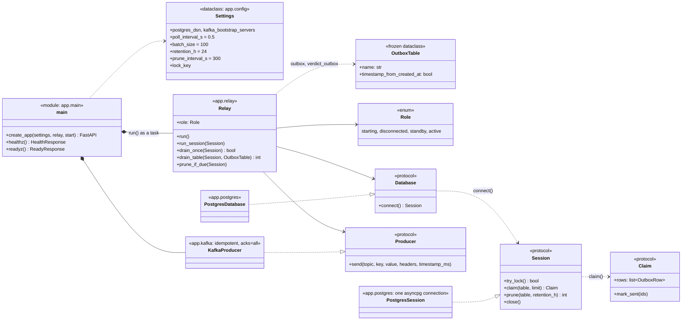

# outbox-relay — class diagram

As built on Day 15 of `docs/plan.md` (ADR-0030, ADR-0024). A worker, not a
platform service: it drains `ingestion`'s `outbox` and `review-console`'s
`verdict_outbox` to Kafka, one active instance at a time. Its only HTTP
endpoints are `/healthz` and `/readyz`.

- **One active relay**: a `Session` is one Postgres connection. The relay
  drains only after `try_lock()` (`pg_try_advisory_lock`) succeeds on it,
  and the lock is released when that connection closes or drops. Any
  connection error is `DatabaseUnavailable`: the session ends, the role
  becomes `disconnected`, and `run()` reconnects and competes for the lock
  again. A second instance sits in `standby`.
- **`drain_table`**: claims up to `batch_size` `PENDING` rows in `id` order
  (`FOR UPDATE SKIP LOCKED`), sends them one by one with the stored
  `kafka_key` and headers, and marks the sent ones `SENT` in the same
  transaction. A `KafkaUnavailable` stops the batch at that row. Rows
  already sent are committed, the rest stay `PENDING` with no attempt
  counted, and `run_session` backs off. A full batch loops straight away;
  otherwise it sleeps `poll_interval_s`.
- **Timestamps**: `verdict_outbox` rows are sent with `created_at` as the
  Kafka timestamp, because `memory-store` times a verdict by it.
- **Pruning**: `prune_if_due` deletes `SENT` rows older than
  `retention_h` from both tables, every `prune_interval_s`, and only on the
  active relay. `DEAD` rows are kept.
- **Next (Day 16)**: telling a message-specific failure apart from Kafka
  being down (`attempts`, `DEAD` after 5, `alert.received.dlq` for alert
  rows).
