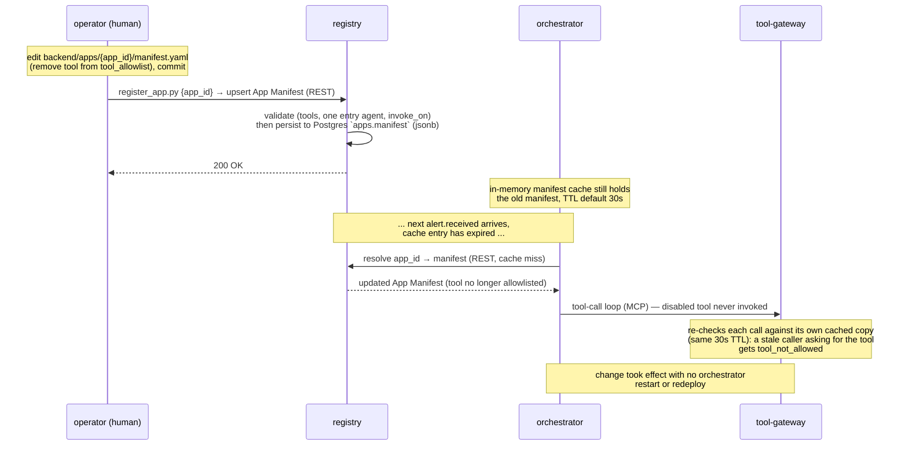
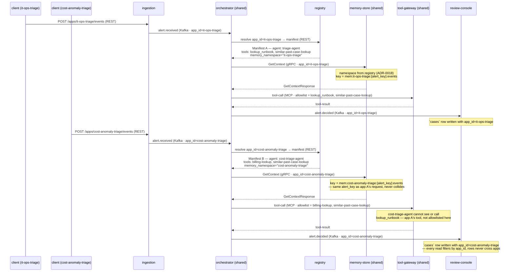

# Sequence diagrams

Five representative flows through the platform, drawn from
`docs/ARCHITECTURE.md` §3–§9. The first three aren't formally named "use
cases" in that doc — they're the sequences that are actually distinct
end-to-end (the fourth possible decision path, `SUPPRESS`, is
sequence-identical to `AUTO_RESOLVE` and is folded into diagram 1). Each
diagram is followed by a services/messages/transport table for quick
reference. Section numbers point back to the source of truth.

Diagram 4 uses a second app, `cost-anomaly-triage`, to make multi-app
isolation visible. It's documented as a second worked example in
`docs/ARCHITECTURE.md` §3, alongside `it-ops-triage`. It's app #2 in
`docs/plan.md`, built on Day 13 (one agent, `billing-lookup`, the shared
`similar-past-case-lookup`) and finished on Day 17 (recurring-spike
suppression on past verdicts, the `anomaly_level` guardrail, and ADR-0031's
noise-verdict rule). App #3, `security-alert-triage`,
follows the exact same sequence as diagram 1/2 with its own manifest and
isn't drawn separately; diagram 5 shows how it's *shipped* (the first app
rolled out on Kubernetes, `docs/plan.md` Day 20, ADR-0014).

Diagrams 1 and 2 draw `ingestion → orchestrator` as a single Kafka hop to
keep them readable. Physically that hop goes through the Postgres `outbox`
and the `outbox-relay` worker (`ARCHITECTURE.md` §10, ADR-0030) — same
message, same consumer, up to ~0.5s added latency (126 ms average when
measured on Day 15). Diagram 2 draws the verdict's path through
`verdict_outbox` and the relay explicitly (ADR-0024).

Two refusals aren't drawn, because nothing runs after them (ADR-0029):
an event over its app's or source's per-minute rate limit gets `429` with
`Retry-After` from `ingestion` and is never published; an entry agent over
its daily token budget isn't run, and `orchestrator` publishes `ESCALATE`
"not evaluated: budget exceeded" straight away, so the alert still reaches
an analyst as in diagram 2 (without the summarizer's contribution if it is
over budget too).

Two delivery cases aren't drawn either (Day 16, `ARCHITECTURE.md` §10). A
second delivery of an `alert.received` that was already decided (the
relay re-publishing after a crash) is skipped by `orchestrator` before any
run: its `seen:{app_id}:{alert_id}` marker in Redis is set once the
decision is published. And an outbox row Kafka refuses five times (e.g.
too large) goes `DEAD` instead of reaching `orchestrator`; an alert row is
copied to `alert.received.dlq` for a human to inspect.

---

## 1. Auto-resolve / suppress — no human involved

The common-case path: `orchestrator` decides without escalating, so
`review-console` receives the event but never persists a case (§4 steps 1–3).

```mermaid
sequenceDiagram
    participant Client as external client
    participant Ingestion as ingestion
    participant Orchestrator as orchestrator
    participant Registry as registry
    participant MemoryStore as memory-store
    participant ToolGateway as tool-gateway
    participant ReviewConsole as review-console

    Client->>Ingestion: POST /apps/{app_id}/events (REST)
    Ingestion->>Ingestion: rate limits (app, source), then validate against event_schema_ref
    Ingestion->>Orchestrator: alert.received (Kafka · RunAgentRequest)
    Ingestion-->>Client: 202 Accepted (once the outbox row commits; the outbox-relay publishes it)

    Orchestrator->>Registry: resolve app_id → manifest (REST, 30s TTL cache)
    Registry-->>Orchestrator: App Manifest
    Note over Orchestrator: entry agent's daily token budget (Redis) not used up

    Orchestrator->>MemoryStore: GetContext (gRPC)
    MemoryStore-->>Orchestrator: GetContextResponse (windowed aggregates)

    Orchestrator->>ToolGateway: prefetch_tools, no arguments (MCP · ADR-0028)
    ToolGateway-->>Orchestrator: tool-result (in the agent's first message)
    Orchestrator->>ToolGateway: tool-call (MCP, allowlisted tools only)
    ToolGateway-->>Orchestrator: tool-result

    Note over Orchestrator: LLM (with context) → supervisor (confidence ≥ threshold)<br/>→ escalate_when guardrails (none matched) → decision = AUTO_RESOLVE or SUPPRESS

    Orchestrator->>ReviewConsole: alert.decided (Kafka · RunAgentResponse)
    Note over ReviewConsole: decision ≠ ESCALATE →<br/>not persisted to `cases`, no analyst action
    Orchestrator->>MemoryStore: alert.decided (Kafka · own consumer group)
    Note over MemoryStore: one decision event in memory_events + Redis<br/>— the next GetContext for this alert_key counts it
```

| Step | Services | Message | Transport |
|---|---|---|---|
| 1 | client → `ingestion` | event payload | REST |
| 2 | `ingestion` → `orchestrator` | `alert.received` (`RunAgentRequest`) | Kafka |
| 3 | `orchestrator` → `registry` | manifest read | REST |
| 4 | `orchestrator` → `memory-store` | `GetContext` | gRPC |
| 5 | `orchestrator` → `tool-gateway` | prefetched tool-calls (e.g. `similar-past-case-lookup`), then the agent's own | MCP |
| 6 | `orchestrator` → `review-console` | `alert.decided` (`RunAgentResponse`) | Kafka |
| 7 | `orchestrator` → `memory-store` | `alert.decided`, same message, separate consumer group (ADR-0016) | Kafka |

Between steps 3 and 4, the budget check is a Redis read; the tokens the
agent used are added after its loop.

---

## 2. Escalate — delegation + human review + verdict feedback

The full loop: entry agent delegates to the callable agent, a case lands in
front of an analyst, and the verdict flows back to close the loop (§3 agent
delegation, §5 delegation call, §4 steps 4–5).

```mermaid
sequenceDiagram
    participant Client as external client
    participant Ingestion as ingestion
    participant Orchestrator as orchestrator (triage-agent)
    participant Registry as registry
    participant MemoryStore as memory-store
    participant ToolGateway as tool-gateway
    participant ReviewConsole as review-console
    participant Analyst as analyst (human)
    participant Relay as outbox-relay (worker)

    Client->>Ingestion: POST /apps/{app_id}/events (REST)
    Ingestion->>Ingestion: rate limits (app, source), then validate against event_schema_ref
    Ingestion->>Orchestrator: alert.received (Kafka · RunAgentRequest)
    Ingestion-->>Client: 202 Accepted (once the outbox row commits; the outbox-relay publishes it)

    Orchestrator->>Registry: resolve app_id → manifest (REST, 30s TTL cache)
    Registry-->>Orchestrator: App Manifest
    Note over Orchestrator: triage-agent's daily token budget (Redis) not used up

    Orchestrator->>MemoryStore: GetContext (gRPC)
    MemoryStore-->>Orchestrator: GetContextResponse

    Orchestrator->>ToolGateway: prefetch: similar-past-case-lookup {} (MCP · ADR-0028)
    Note over ToolGateway: reads review-console's resolved cases for the run's<br/>app_id + alert_key, from _meta (ADR-0027)
    ToolGateway-->>Orchestrator: past cases incl. resolution_notes (as data)
    Orchestrator->>ToolGateway: tool-call (MCP, allowlisted tools only)
    ToolGateway-->>Orchestrator: tool-result

    Note over Orchestrator: LLM → supervisor → escalate_when guardrails<br/>(any can raise to ESCALATE) → final decision = ESCALATE

    Note over Orchestrator: callables with invoke_on ∋ ESCALATE →<br/>root-cause-summarizer (in-process graph branch,<br/>parallel if several, each within its own budget · ADR-0012/0022)
    Orchestrator->>ToolGateway: tool-call, summarizer's allowlist:<br/>recent-changes-lookup (2h before fired_at), lookup_runbook (MCP)
    ToolGateway-->>Orchestrator: tool-result
    Note over Orchestrator: summarizer answers {"reasons": [...]}:<br/>probable cause citing a change ref or runbook
    Note over Orchestrator: orchestrator folds summarizer's reasons[]<br/>into triage-agent's, prefixed "root-cause-summarizer: ...",<br/>and appends its tool calls (agent_id-tagged · ADR-0023)

    Orchestrator->>ReviewConsole: alert.decided (Kafka · RunAgentResponse, decision=ESCALATE,<br/>incl. the alert itself · ADR-0023)
    Note over ReviewConsole: persists an OPEN `cases` row (Postgres, app_id-scoped)
    Orchestrator->>MemoryStore: alert.decided (Kafka · own consumer group)
    Note over MemoryStore: records decision:ESCALATE for that alert_key

    Analyst->>ReviewConsole: GET case list/detail (REST)
    ReviewConsole-->>Analyst: case incl. the alert, reasons[], tool_calls[] (explainability trace)
    Analyst->>ReviewConsole: submit verdict + optional resolution_notes (REST)
    Note over ReviewConsole: OPEN → RESOLVED exactly once (a second verdict is a 409);<br/>the verdict.recorded event is written to verdict_outbox<br/>in the same transaction (ADR-0024) — no Kafka on this path
    Note over ReviewConsole: resolution_notes stored on the case only —<br/>later surfaced via similar-past-case-lookup

    ReviewConsole-->>Analyst: 200 (also while Kafka is down)
    Relay->>Relay: claim PENDING verdict_outbox rows in id order<br/>(holds the Postgres advisory lock · ADR-0030)
    Relay->>MemoryStore: verdict.recorded (Kafka · {app_id, case_id, alert_key, verdict, verdict_by, recorded_at};<br/>Kafka timestamp = row created_at)
    MemoryStore->>MemoryStore: record a verdict event in memory_events + Redis<br/>for that alert_key (closes feedback loop)
```

| Step | Services | Message | Transport |
|---|---|---|---|
| 1 | client → `ingestion` | event payload | REST |
| 2 | `ingestion` → `orchestrator` | `alert.received` (`RunAgentRequest`) | Kafka |
| 3 | `orchestrator` → `registry` | manifest read | REST |
| 4 | `orchestrator` → `memory-store` | `GetContext` | gRPC |
| 5 | `orchestrator` → `tool-gateway` | prefetched `similar-past-case-lookup`, then triage-agent's tool-calls | MCP |
| 6 | `orchestrator` (in-process) | callable `root-cause-summarizer` runs as a branch of the run graph | — |
| 7 | `orchestrator` → `tool-gateway` | tool-call / tool-result (summarizer, its own `agent_id` in `_meta`) | MCP |
| 8 | `orchestrator` → `review-console` | `alert.decided` (`RunAgentResponse`, ESCALATE) | Kafka |
| 9 | `orchestrator` → `memory-store` | `alert.decided`, separate consumer group (ADR-0016) | Kafka |
| 10 | analyst → `review-console` | case read / verdict submit | REST |
| 11 | `review-console` → Postgres `verdict_outbox` | the `verdict.recorded` event, in the case's transaction | SQL |
| 12 | `outbox-relay` → `memory-store` | `verdict.recorded` (timestamped by the row's `created_at`) | Kafka |

---

## 3. Manifest edit — no redeploy, takes effect within one TTL window

Demonstrates the "config, not code" promise: an operator removes a tool
from an agent's allowlist in the app's checked-in `manifest.yaml` and runs
`register_app.py`, and the next alert for that app picks up the change
without an `orchestrator` restart (§3: "this is what `plan.md` Day 5's 'no code change
or redeploy' definition of done depends on").



| Step | Services | Message | Transport |
|---|---|---|---|
| 1 | operator (`register_app.py`) → `registry` | manifest upsert | REST |
| 2 | `registry` → Postgres | persist `apps.manifest` (jsonb) | internal (Postgres write) |
| 3 | `orchestrator` → `registry` | manifest read, post-TTL-expiry | REST |
| 4 | `orchestrator` → `tool-gateway` | tool-call (now minus the disabled tool) | MCP |

---

## 4. Two apps, one shared core — isolation in practice

*Built — `cost-anomaly-triage`, `docs/plan.md` Days 13 and 17.* Same `orchestrator`,
`tool-gateway`, `memory-store` process handling both apps' alerts back to
back, showing where the §3 isolation guarantee (`app_id`, `memory_namespace`,
`tool_allowlist`) actually bites. Prefetch and the budget check (diagram 1)
happen in both runs and aren't redrawn.



| Step | Services | Message | Transport | Isolation mechanism |
|---|---|---|---|---|
| 1–2 | client A → `ingestion` → `orchestrator` | event / `alert.received` (`app_id=it-ops-triage`) | REST / Kafka | `app_id` carried on every payload |
| 3 | `orchestrator` → `registry` | manifest read | REST | manifest lookup keyed by `app_id` |
| 4 | `orchestrator` → `memory-store` | `GetContext` | gRPC | `memory_namespace` prefixes the Redis key |
| 5 | `orchestrator` → `tool-gateway` | tool-call | MCP | `tool_allowlist` scopes which tools this app's agent can reach |
| 6 | `orchestrator` → `review-console` | `alert.decided` | Kafka | `cases` row carries `app_id`, filtered on every read |
| 7–12 | same steps, client B, `app_id=cost-anomaly-triage` | — | — | identical mechanisms, disjoint values — same `alert_key` on both sides never collides |

`similar-past-case-lookup` (`scope: global`) is allowlisted by both apps
— one implementation, but it reads the run's `app_id` and `alert_key`
from the MCP request context, never from an argument (ADR-0027), so each
app only ever sees its own past cases; an `app_id` argument is
`invalid_arguments`. `billing-lookup` and `lookup_runbook` are
`scope: app` and can never appear outside the manifest that declares
them: on Day 13, `triage-agent` → `billing-lookup` and
`cost-triage-agent` → `lookup_runbook` were both `tool_not_allowed`, and a
cost-app case came back `found: false` for `it-ops-triage` with the same
key text. Each app's `rate_limit` and each agent's `budget` are separate
counters too, so one app's flood or spend never uses up another's.

---

## 5. Adding an app on Kubernetes — rolling update, then registration

*The mechanism is built and measured (`docs/plan.md` Day 19, ADR-0014,
ADR-0033); app #3 is the first app shipped with it (Day 20).* App #3 and
every app after it ship this way. Code goes first, one pod at a time, while other
apps keep being served. The manifest is registered only when every pod of
all three services runs the new image, so the new app can't receive an
event that an old pod can't handle (§12 rollout order, ADR-0006).

```mermaid
sequenceDiagram
    participant Operator as operator (rollout_app.sh)
    participant K8s as Kubernetes
    participant Old as old pods<br/>(ingestion / orchestrator / tool-gateway)
    participant New as new pods
    participant Registry as registry
    participant Client as alert source (app #3)

    Operator->>K8s: build, kind load, kubectl set image (new git-SHA tag) ×3 Deployments
    loop per pod, maxUnavailable 0 / maxSurge 1
        K8s->>New: start pod
        New-->>K8s: /readyz 200 (startup done / consumer joined + registry, tool-gateway up / outbox reachable)
        K8s->>Old: preStop sleep 5s (leaves Service endpoints)
        K8s->>Old: SIGTERM
        Note over Old: /readyz → 503; uvicorn finishes in-flight<br/>requests and MCP calls; orchestrator finishes<br/>its current alert, publishes, commits, LeaveGroup
        Old-->>K8s: exit
    end
    Note over Old,New: each orchestrator join/leave is a Kafka rebalance:<br/>members finish and commit their current alert<br/>before their partitions move (sticky, ADR-0033)
    Note over Old,New: apps #1/#2 served throughout —<br/>no non-202s, no tool-call failures
    Operator->>K8s: kubectl rollout status ×3 (all complete)
    Operator->>Registry: register_app.py {app_id} (REST, via its own port-forward to the new pods)
    Registry-->>Operator: 200 OK (validated)
    Client->>New: POST /apps/{app_id}/events (accepted after the 30s manifest TTL at most)
```

| Step | Who | What | Transport |
|---|---|---|---|
| 1 | operator → Kubernetes | build, `kind load`, new image tag on `ingestion`, `orchestrator`, `tool-gateway` | `docker`, `kind`, `kubectl` |
| 2 | Kubernetes ↔ pods | start new pod, wait for `/readyz`, `preStop` then SIGTERM an old pod, which drains; repeat | HTTP probes, SIGTERM |
| 3 | operator → Kubernetes | wait for all three rollouts to complete | `kubectl rollout status` |
| 4 | operator → `registry` | register the new app's manifest | REST |
| 5 | alert source → `ingestion` | first events for the new app | REST |

Before step 4, `ingestion` rejects the new `app_id` (no registered
manifest), so nothing for the new app is in flight while old and new pods
coexist. A pod that fails `/readyz` stalls the rollout with old pods still
serving; `rollout_app.sh` then exits without registering, and `kubectl
rollout undo` reverts it. Measured on Day 19: 120 alerts across apps #1
and #2 during a code-only rollout, all `202`, each decided exactly once,
no tool-call failures.
